# 🥬 Sistema Fruver — Frontend Web & PWA

<div align="center">

[](https://react.dev/)
[](https://vitejs.dev/)
[](https://tailwindcss.com/)
[-4B32C3?logo=eslint&logoColor=white)](https://eslint.org/)
[](https://web.dev/progressive-web-apps/)
[](LICENSE)
[](https://github.com/williamfraile84/Backend-Remisiones)

**Plataforma Frontend Progresiva de Alta Disponibilidad para Logística, Despachos, Compras y Liquidación Mayorista de Frutas y Verduras.**

[Explorar Vistas](#-galería-visual-de-la-aplicación) •
[Arquitectura](#-arquitectura-del-frontend) •
[Instalación Rápida](#-instalación-y-despliegue) •
[Módulos y Flujos](#-módulos-operativos-principales) •
[Atajos de Teclado](#-ergonomía-y-atajos-de-teclado)

</div>

---

## 🌟 Resumen Ejecutivo

**Sistema Fruver Frontend** es una Single Page Application (SPA) y Progressive Web App (PWA) de nivel corporativo desarrollada para agilizar la operación diaria de comercialización de productos agrícolas y perecederos en plazas mayoristas y centros de acopio (Corabastos, Paloquemao, centrales de abastos).

La interfaz ha sido diseñada priorizando la **velocidad de captura**, **resiliencia offline**, **cero pérdida de datos** mediante autoguardado continuo, y una ergonomía visual óptima con soporte nativo para **Modo Claro** y **Modo Oscuro**.

### 💎 Principales Capacidades de la Interfaz
- ⚡ **Toma ultrarrápida de pedidos:** Búsqueda predictiva con coincidencias fonéticas, selección táctil o por teclado numérico.
- 🤖 **Asistente inteligente de texto (OCR / WhatsApp):** Parser de texto desestructurado que convierte mensajes de chat o escaneos en pedidos estructurados en segundos.
- 📦 **Calculadora matricial de empaques:** Conversión bidireccional entre bultos, canastillas, mallas, arrobas y kilos netos descontando tara y tolerancias de merma.
- 🔄 **Sincronización POS bidireccional:** Conciliación visual de precios en tiempo real contra terminales de punto de venta.
- 📊 **Liquidación financiera y costeo:** Prorrateo paramétrico de fletes, gastos operativos y cálculo en vivo del margen bruto y neto.
- 🌓 **Sistema Dual Dark / Light Mode:** Paleta cromática calibrada con contraste WCAG 2.1 AA para terminales de bodega o despachos en exteriores.

---

## 📸 Galería Visual de la Aplicación

> Todas las capturas fueron tomadas directamente sobre la aplicación en funcionamiento en resolución Full HD (1440×900) con datos operativos reales.

### 1. Panel de Toma de Pedidos & Despachos
*Gestión centralizada de remisiones, validación de clientes institucionales, autoguardado en background y detector de novedades ortográficas.*

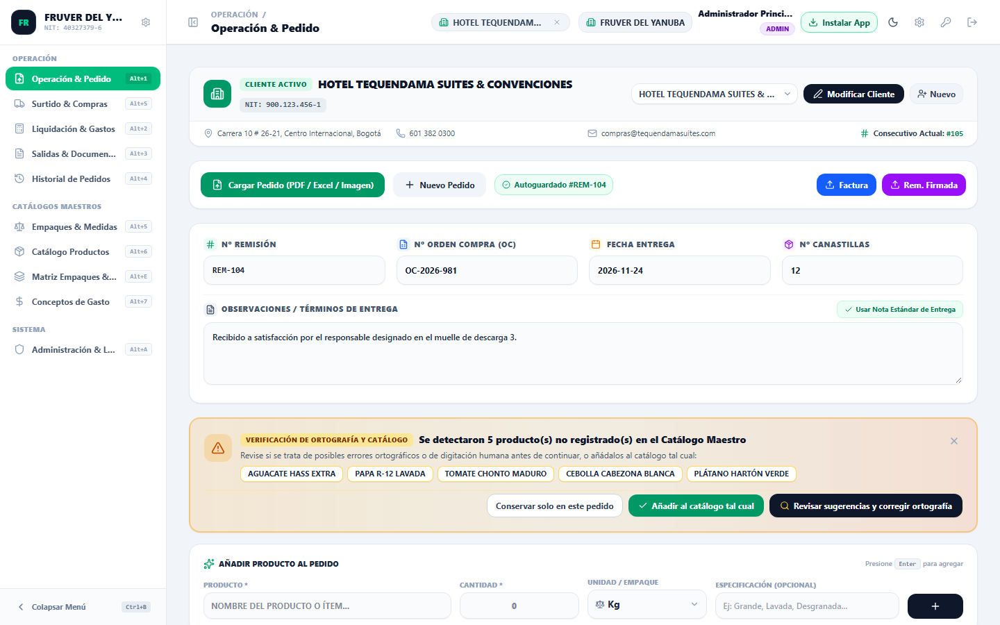

---

### 2. Modo Oscuro (Dark Theme) — Reducción de Fatiga Visual
*Paleta Slate/Emerald optimizada para operarios de bodega, cuartos fríos y jornadas nocturnas de cargue.*

| Modo Claro | Modo Oscuro |
| :---: | :---: |
|  | 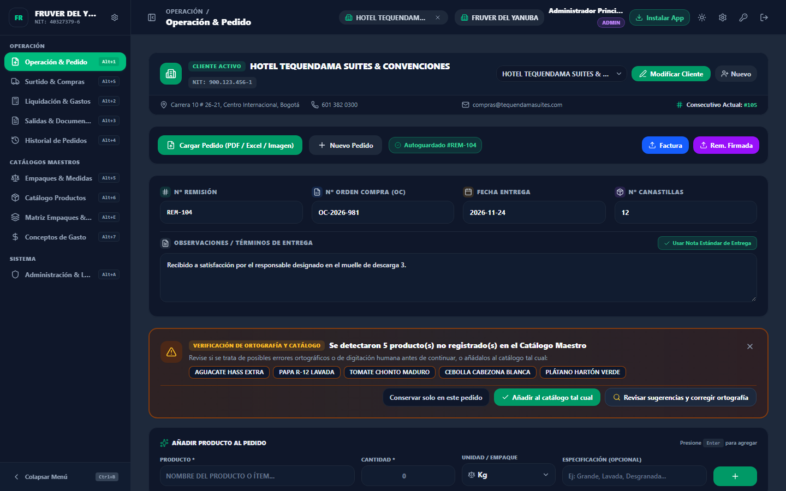 |

---

### 3. Asistente Inteligente de Carga por Texto (OCR / WhatsApp)
*Importación en 1 clic de notas desordenadas, listas de compras de chefs o transcripciones de voz.*

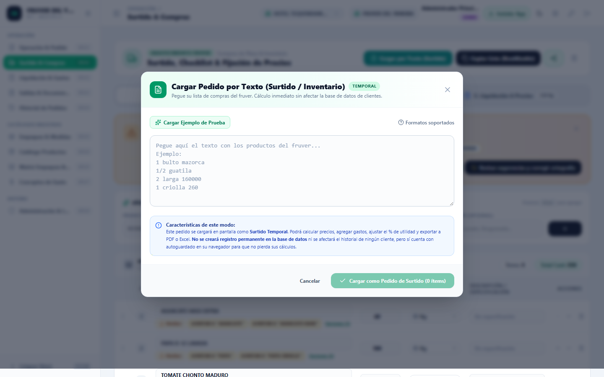

---

### 4. Calculadora de Empaques, Mallas y Bultos con Tara
*Costeo físico matemático por presentación comercial, pesaje neto y redondeo estricto a la centena.*

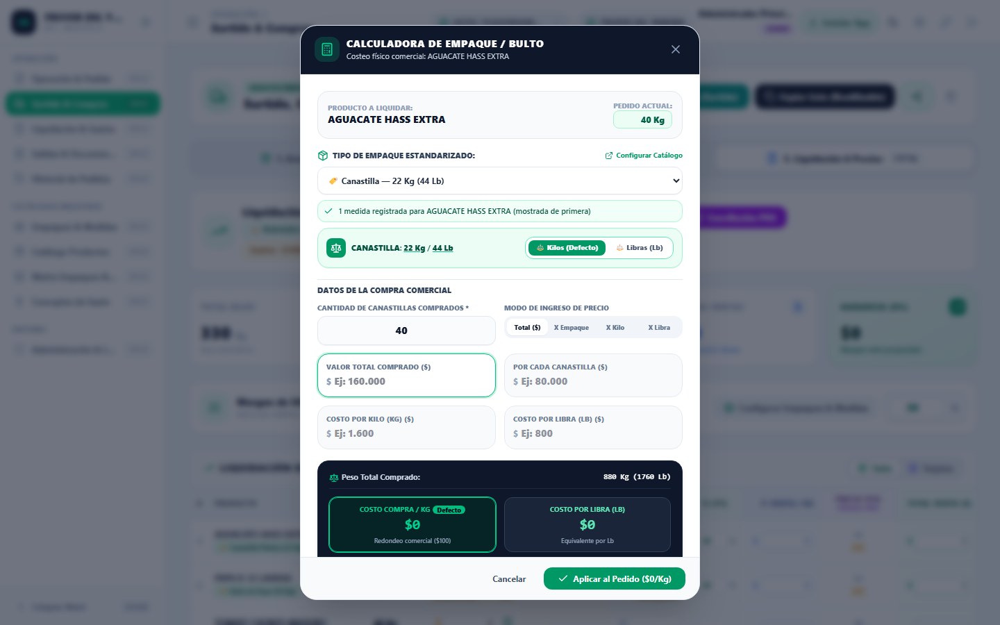

---

### 5. Surtido y Abastecimiento de Plaza (3 Fases)

<details open>
<summary><b>Fase 1: Requerimientos Consolidados de Compra</b></summary>
<br>

*Consolidación automática de las necesidades de todos los clientes para compra en plaza mayorista.*

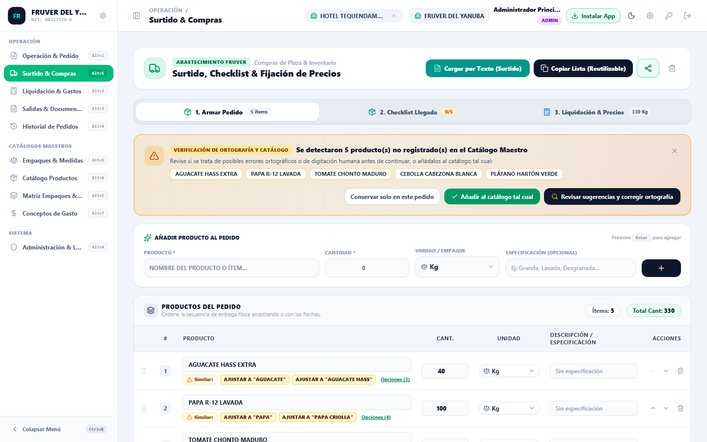
</details>

<details>
<summary><b>Fase 2: Checklist de Llegada, Pesaje en Báscula & Calidad</b></summary>
<br>

*Recepción física con verificación de mermas, peso real en muelle y reporte de novedades.*

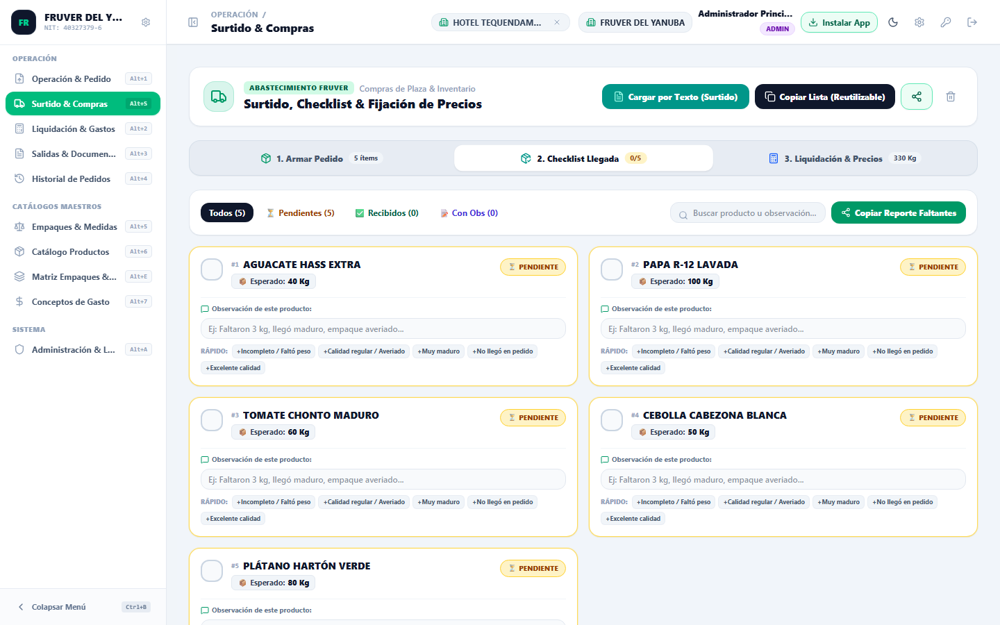
</details>

<details>
<summary><b>Fase 3: Liquidación de Costos & Fijación de Precios de Venta</b></summary>
<br>

*Costeo final por kilo, aplicación de margen comercial y actualización al catálogo maestro.*

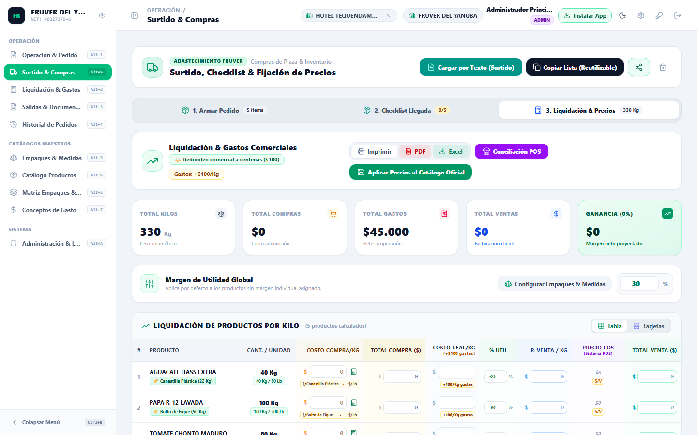
</details>

---

### 6. Conciliación Automática de Precios POS
*Comparativa en paralelo de tarifas sugeridas vs tarifas cargadas en el punto de venta.*

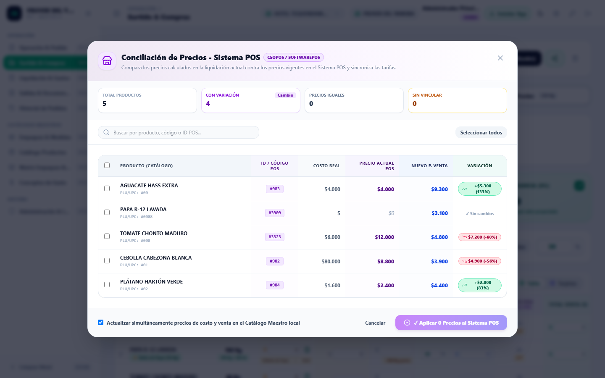

---

### 7. Liquidación Financiera & Prorrateo de Fletes
*Auditoría de rentabilidad por producto, utilidad neta en pesos colombianos ($ COP) y gestión de costos variables.*

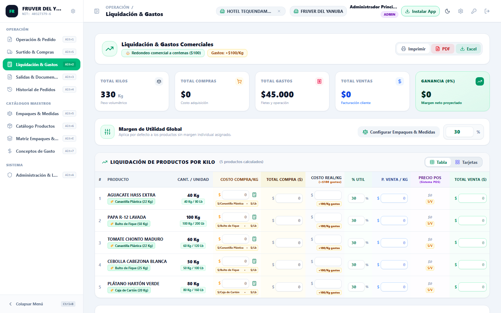

---

### 8. Matriz Relacional de Empaques (3NF)
*Configuración granular de los tipos de envase permitidos (bulto, canastilla, huacal, saco) por cada producto del catálogo.*

| Modo Claro | Modo Oscuro |
| :---: | :---: |
| 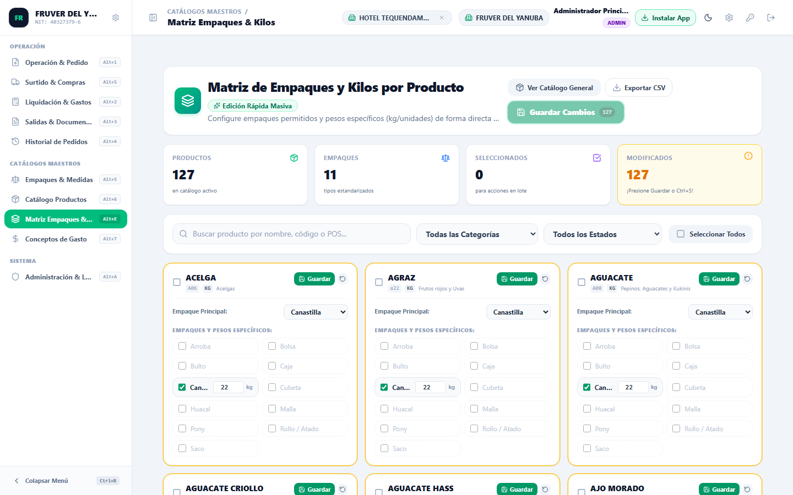 | 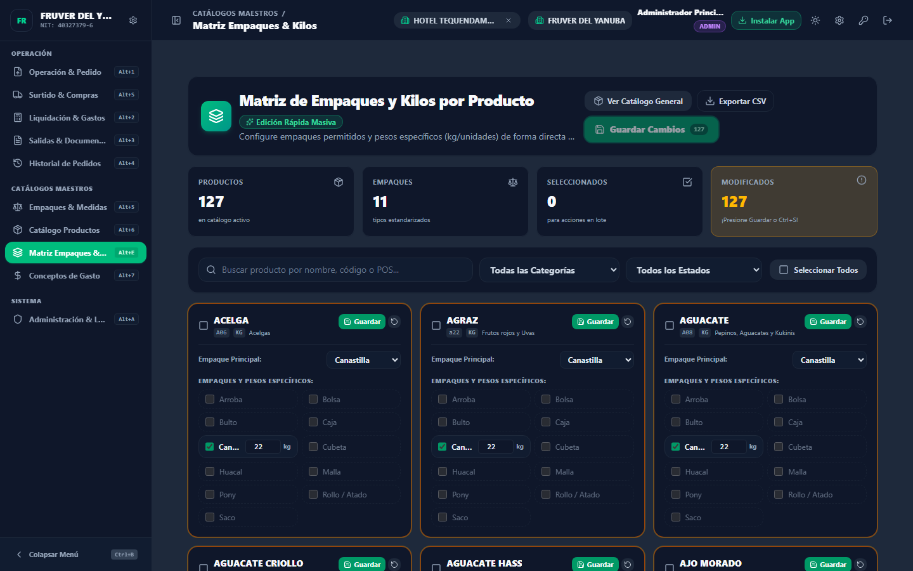 |

---

### 9. Catálogo Taxonómico Maestro de Productos
*Más de 120 referencias hortofrutícolas organizadas por categorías taxonómicas con búsqueda en tiempo real.*

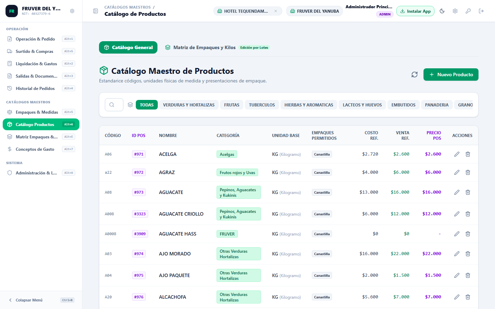

---

### 10. Seguridad y Auditoría Forense RBAC
*Gestión de usuarios con matriz de 29 permisos granulares y bitácora forense inmutable de operaciones.*

| Control de Usuarios RBAC | Bitácora de Auditoría Forense |
| :---: | :---: |
| 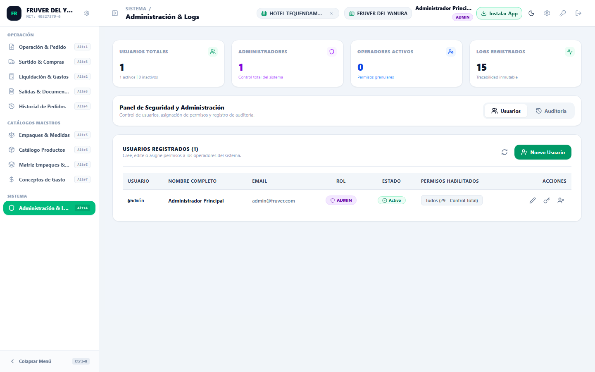 | 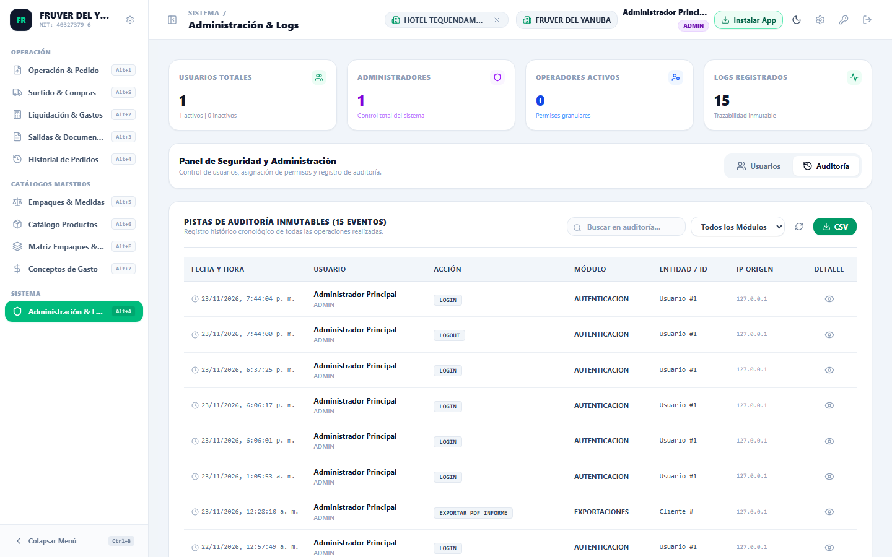 |

---

### 11. Acceso y Autenticación Segura
*Inicio de sesión con JWT cifrado, cierre de sesiones por inactividad y recuperación de credenciales.*


---

## 🏗 Arquitectura del Frontend

El cliente frontend implementa una arquitectura modular desacoplada basada en componentes puros, contextos atómicos y hooks reactivos reutilizables:

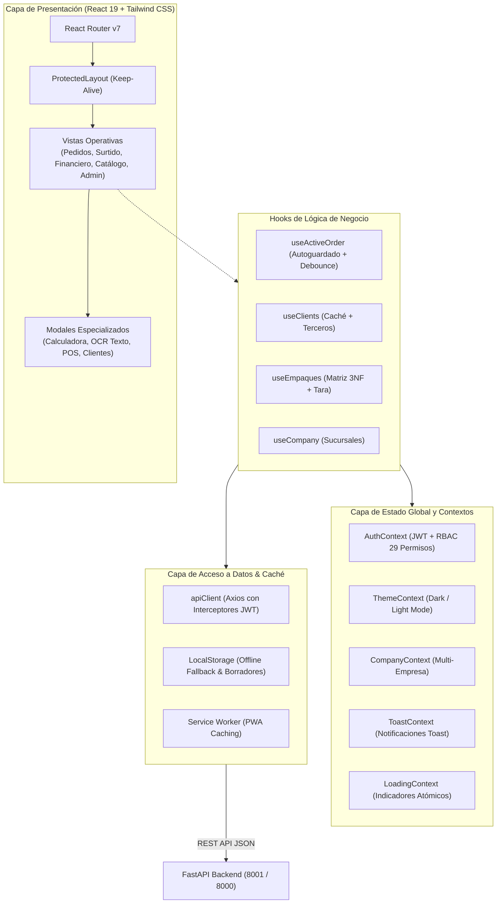

### 📁 Estructura del Proyecto

```text
sistema-fruver-frontend/
├── public/                 # Favicons, manifiesto PWA e iconos SVG
├── src/
│   ├── api/                # Clientes API con Axios e interceptores de seguridad
│   │   ├── apiClient.js    # Cliente central con inyección de JWT y cabeceras
│   │   ├── orderApi.js     # Endpoints de pedidos, remisiones y autoguardado
│   │   ├── productApi.js   # Catálogo de productos y conciliación POS
│   │   ├── clientApi.js    # Clientes institucionales y consecutivos
│   │   ├── empaqueApi.js   # Tipos de empaque y matriz 3NF
│   │   ├── auditApi.js     # Bitácora forense de auditoría
│   │   └── userApi.js      # Usuarios y matriz de permisos RBAC
│   ├── components/         # Componentes UI reutilizables
│   │   ├── common/         # Botones, Error Boundaries, Loaders, Toasts
│   │   ├── layout/         # TopBar, Sidebar colapsable, MobileNav, Layout
│   │   ├── modals/         # Modales (Calculadora, Texto OCR, POS, Clientes)
│   │   ├── orders/         # Tablas de items, formulario de captura, gastos
│   │   └── summary/        # Tarjetas de totales, márgenes y métricas
│   ├── context/            # Proveedores de contexto de React (Auth, Theme, etc.)
│   ├── hooks/              # Custom hooks con la lógica desacoplada
│   ├── utils/              # Funciones puras (cálculo de tara, divisas, NLP)
│   ├── views/              # Vistas principales del sistema (rutas)
│   ├── App.jsx             # Enrutador principal y guardianes de ruta
│   ├── index.css           # Estilos base con Tailwind CSS y variables CSS
│   └── main.jsx            # Punto de entrada Vite con montaje seguro
├── docs/screenshots/       # 20 capturas Full HD integradas en la documentación
├── Dockerfile              # Contenedor optimizado Nginx Alpine (Multi-stage)
├── nginx.conf              # Configuración Nginx para SPA con compresión Gzip
├── package.json            # Dependencias y scripts de construcción
├── vite.config.js          # Configuración de empaquetado Vite
└── README.md               # Esta documentación
```

---

## ⌨️ Ergonomía y Atajos de Teclado

La interfaz permite a un operario experimentado despachar pedidos enteros sin tocar el mouse:

| Atajo | Módulo o Acción | Descripción |
| :---: | :--- | :--- |
| <kbd>Alt</kbd> + <kbd>1</kbd> | **Operación & Pedido** | Ir a la pantalla de captura de pedido activo |
| <kbd>Alt</kbd> + <kbd>S</kbd> | **Surtido & Compras** | Ir al módulo de compras de plaza (requerimientos) |
| <kbd>Alt</kbd> + <kbd>2</kbd> | **Liquidación & Gastos** | Ir al módulo financiero y costeo de fletes |
| <kbd>Alt</kbd> + <kbd>3</kbd> | **Salidas & Documentos** | Repositorio documental de remisiones y facturas |
| <kbd>Alt</kbd> + <kbd>4</kbd> | **Historial de Pedidos** | Consulta de pedidos y remisiones archivadas |
| <kbd>Alt</kbd> + <kbd>5</kbd> | **Empaques & Medidas** | Maestro de bultos, canastillas y mallas |
| <kbd>Alt</kbd> + <kbd>6</kbd> | **Catálogo Productos** | Listado general de productos agrícolas |
| <kbd>Alt</kbd> + <kbd>E</kbd> | **Matriz de Empaques** | Configuración de empaques permitidos por ítem |
| <kbd>Alt</kbd> + <kbd>A</kbd> | **Administración & Logs** | Panel RBAC y bitácora de auditoría |
| <kbd>Ctrl</kbd> + <kbd>B</kbd> | **Colapsar / Expandir Menú** | Maximiza el área de trabajo en pantallas compactas |
| <kbd>Enter</kbd> | **Añadir Línea al Pedido** | Agrega el producto seleccionado a la tabla activa |

---

## 🚀 Instalación y Despliegue

### Requisitos Previos
- **Node.js**: Versión 18.0 o superior (recomendado 20+ LTS).
- **npm** o **pnpm**.

### 1. Clonar el Repositorio
```bash
git clone https://github.com/williamfraile84/Frontend-Remisiones.git
cd sistema-fruver-frontend
```

### 2. Configurar Variables de Entorno
Copia el archivo de ejemplo:
```bash
cp .env.example .env
```
Configura la URL de tu API Backend:
```env
VITE_API_BASE_URL=/api
VITE_APP_TITLE=Sistema Fruver
VITE_DEFAULT_PROFIT_MARGIN=30
VITE_AUTO_SAVE_DELAY_MS=600
```

### 3. Instalar Dependencias y Arrancar Servidor de Desarrollo
```bash
npm install
npm run dev
```
La aplicación quedará disponible en `http://localhost:5174/`.

### 4. Compilación para Producción
```bash
npm run build
```
Genera la carpeta ultra-optimizada `dist/` en ~1.8 segundos, lista para ser servida con Nginx, Cloudflare Pages, Vercel o directamente desde el backend FastAPI.

### 5. Despliegue con Docker
```bash
# Construir imagen con Nginx Alpine multi-stage
docker build -t sistema-fruver-frontend:latest .

# Ejecutar contenedor en puerto 80
docker run -d -p 80:80 --name fruver-web sistema-fruver-frontend:latest
```

---

## 🛡️ Calidad de Código y Pruebas

El código ha sido auditado de forma exhaustiva con ESLint v9 en modo estricto:
```bash
npx eslint src
```
- ✅ **0 Errores**
- ✅ **0 Advertencias (Warnings)**
- ✅ Componentes libres de re-renderizados en cascada
- ✅ Sin fugas de memoria en hooks y temporizadores

---

## 🤝 Repositorio Backend

Este frontend consume la API REST de alto rendimiento:
👉 **[Repositorio Backend — Sistema Fruver (FastAPI + Python 3.12)](https://github.com/williamfraile84/Backend-Remisiones)**

---

## 📄 Licencia

Distribuido bajo la Licencia **MIT**. Consulta el archivo [LICENSE](LICENSE) para más detalles.
